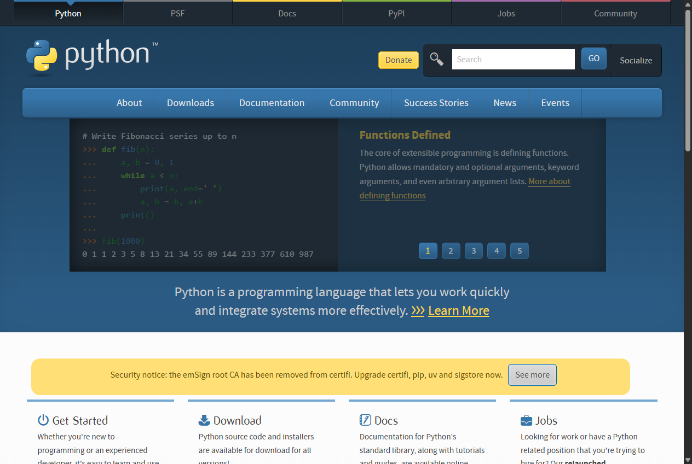
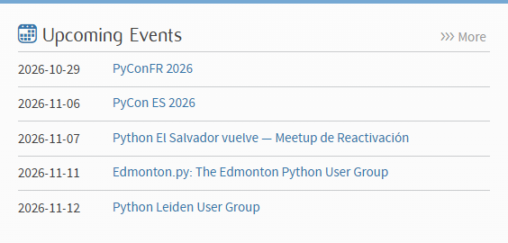
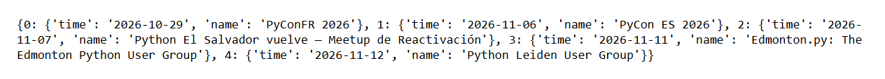

# 🚀 048 – Scraping python.org with Selenium

Day 48 of Udemy's *100 Days of Code: The Complete Python Pro Bootcamp*: scrape
the five upcoming events from [python.org](https://www.python.org/) with
Selenium and print them as a dictionary. This is a modernised version of the
original solution.

## 📚 Table of Contents

- [Overview](#-overview)
- [Requirements](#-requirements)
- [Setup](#-setup)
- [Run](#-run)
- [Tests](#-tests)
- [License](#-license)
- [Links](#-links)
- [Appendix: Project documents](#-appendix-project-documents)

## 🧭 Overview

The program opens python.org in headless Chrome, reads the *Upcoming Events*
widget and prints:

```python
{0: {'time': '2026-10-29', 'name': 'PyConFR 2026'}, 1: {...}, ..., 4: {...}}
```

| Path | Purpose |
| --- | --- |
| `src/scraping_python_org/domain` | The `Event` value object |
| `src/scraping_python_org/application` | The use case and the `EventSource` port |
| `src/scraping_python_org/infrastructure` | Selenium and Chrome adapters |
| `src/scraping_python_org/presentation` | Command line entry point and screenshot capture |
| `tests/` | Unit tests and a headless browser test against a saved page |
| `docs/wiki/` | Wiki in English, Danish and Bahasa Malaysia |

### The lecture steps

**1. Open the page.** python.org loads in the browser.



**2. Locate the widget.** Inspect the page: the events sit in the
`.event-widget` element, each in an `li` with a `time` and an `a` tag.



**3. Select the five list items** with the CSS selector `.event-widget li`
(outlined in red).


**4. Build the dictionary** with a `for` loop and print it.



What each step teaches is in the [wiki](docs/wiki/Home.md).

## 📋 Requirements

- Python 3.11 or newer (developed on 3.13).
- Google Chrome. Selenium Manager downloads a matching driver by itself.

## 🛠️ Setup

```bash
python -m venv .venv
source .venv/Scripts/activate   # Windows Git Bash; on Linux/macOS: .venv/bin/activate
pip install -e ".[dev]"
```

## ▶️ Run

```bash
python -m scraping_python_org
```

Regenerate the screenshots:

```bash
python -m scraping_python_org.presentation.screenshots
```

## 🧪 Tests

```bash
pytest
```

The `browser` test starts headless Chrome on a saved HTML page; skip it with
`pytest -m "not browser"`.

## 📄 License

See [LICENSE](./LICENSE).

## 🔗 Links

- [Repository][repository]
- [Documentation][documentation]
- [Issue tracker][issues]

## 📎 Appendix: Project documents

| Document | What it tells you |
| --- | --- |
| [AGENTS.md][agents] | The rules AI agents follow in this repository |
| [Artifact registry][registry] | The PO language and where artifacts live |
| [Framework README][framework-readme] | The framework this project uses |
| [Framework changelog][framework-changelog] | What changed in each framework release |

---

[repository]: https://git.tirsystem.com/Tirsvad-Udemy-100-days-of-code/048-scrapping-python-org
[documentation]: ./docs/wiki/Home.md
[issues]: https://git.tirsystem.com/Tirsvad-Udemy-100-days-of-code/048-scrapping-python-org/issues
[agents]: ./AGENTS.md
[registry]: ./docs/artifact-registry.md
[framework-readme]: ./framework/README.md
[framework-changelog]: ./framework/CHANGELOG.md
