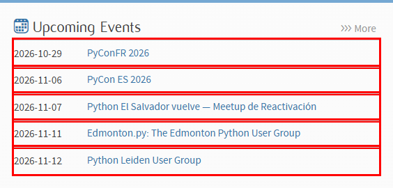

**English** · [Dansk](Lecture-Steps-da) · [Bahasa Malaysia](Lecture-Steps-ms)

# Lecture steps

## Step 1 – Open the page

`driver.get("https://www.python.org/")` loads the page in Chrome.

**What you gain:** the driver is your remote control for a real browser. It
must always be closed again, so the modern code wraps it in `try/finally`.

## Step 2 – Locate the widget with the inspector

Right-click the widget and choose *Inspect*. The events live inside an element
with the class `event-widget`; each event is an `li` holding a `time` and an
`a` tag.

**What you gain:** you learn to read the HTML tree and find the container that
holds exactly the data you want.

## Step 3 – Select the five list items with a CSS selector

`driver.find_elements(By.CSS_SELECTOR, ".event-widget li")` returns the five
items. A class-based selector is shorter and more stable than the long XPath
copied from the inspector, and it does not match unrelated links.

**What you gain:** you know the Selenium locator strategies and when CSS
selectors beat XPath.

## Step 4 – Build the dictionary

For every item we read `time` and `a` and store them under the item's index,
with `enumerate` instead of a manual counter.

**What you gain:** you turn page elements into structured data: a dictionary
of dictionaries, ready to use in the rest of a program.
